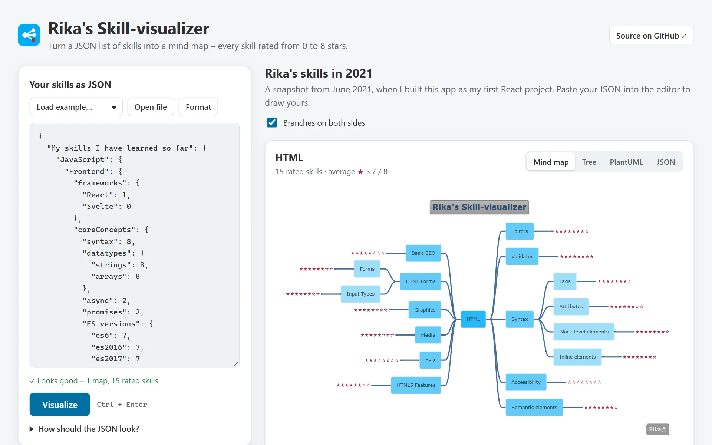

# Rika's skill-visualizer

My very first React app, from June 2021: it turns a JSON list of skills into a mind map, every skill rated from
0 to 8 stars. Renovated in 2026 with Vite, React 19, a new one-screen UI and my skills
from 2026.

I've always liked visual overviews – they make things much easier to take in. So I wondered: what if my knowledge
could be seen too, like a tree and its branches? Before a job interview I was asked to put together a small hobby
project of my own, and this is what came of it :)

**Live site:** https://mazsola739.github.io/skill-visualizer/



- Everything fits on one screen: the tabs on top choose what you see.
  - **2026** – my front end (opens first), back end and other skills today.
  - **2021** – my HTML, CSS, JavaScript and other skills from when I built the app.
  - **Draw yours** – paste your skills as JSON, load an example or open a `.json` file; the editor checks it as
    you type. On phones a switch flips between the JSON and the map.
- The mind map fits the box; **−**, **Fit** and **+** zoom out and in, and a zoomed map can be dragged around.
- Every map can also be viewed as an ASCII **tree**, the generated **PlantUML** source or the **JSON** itself,
  copied, or opened as SVG / PNG.
- Branches are split evenly to both sides of the map (on phones they start on one side); deeper levels get
  lighter colors.
- The footer has a **Contact me** window – messages reach my inbox through [Web3Forms](https://web3forms.com).
- Every link opens in a new tab.

Part of my portfolio: https://mazsola739.github.io/mazsola739/

## Stack

[Vite](https://vite.dev) · React 19 · JavaScript (JSX) · plain CSS ·
[PlantUML](https://plantuml.com/mindmap-diagram) · GitHub Pages (GitHub Actions)

## How it works

1. Paste your skills as JSON into the editor (or load one of the examples, or open a `.json` file).
2. Press **Visualize** (or <kbd>Ctrl</kbd> + <kbd>Enter</kbd>).
3. The JSON is converted to [PlantUML](https://plantuml.com/mindmap-diagram) mind map syntax and drawn by the public
   PlantUML server, so the JSON you visualize is sent to plantuml.com.
4. Want to tweak a map by hand? Copy its source from the **PlantUML** view and paste it into the online editor at
   [plantuml.com](https://www.plantuml.com/plantuml/uml/).

## JSON format

```json
{
  "My skills": {
    "Frontend": {
      "React": 6,
      "CSS": { "Flexbox": 7, "Grid": 5 }
    },
    "Level": "junior",
    "Tools": ["Git", "npm"]
  }
}
```

| Value                  | Shown as                               |
| ---------------------- | -------------------------------------- |
| object                 | a group of skills                      |
| number (`0`–`8`)       | a star rating, e.g. `★★★★★★☆☆` for 6   |
| text                   | a small note under the skill           |
| array                  | plain items without rating             |
| array of skill objects | several mind maps at once (top level)  |

Ratings above 8 are shown as 8, negative ones as 0.

## Getting started

Requires Node.js 20.19+ (or 22.12+).

```bash
npm install
npm run dev
```

| Command              | What it does                                         |
| -------------------- | ---------------------------------------------------- |
| `npm run dev`        | Starts the Vite dev server.                          |
| `npm run build`      | Builds the static site into `dist/`.                 |
| `npm run preview`    | Serves the production build locally.                 |

## Project structure

```
src/
  App.jsx               page layout and state
  components/           editor, mind map card, zoomable diagram, copy button, contact window
  lib/skillMap.js       JSON → tree / ASCII tree / PlantUML conversion
  lib/plantuml.js       PlantUML server URLs
  lib/parseInput.js     editor input validation
  data/                 my skill maps from 2021 and 2026, and the examples
```

## Deployment

Every push to `master` is built and published to GitHub Pages by `.github/workflows/deploy.yml`.
One-time setup in the repository: **Settings → Pages → Source: GitHub Actions**. On the free plan GitHub Pages
only works for public repositories, so the deploy step is skipped while the repository is private.

## License

[MIT](LICENSE)
